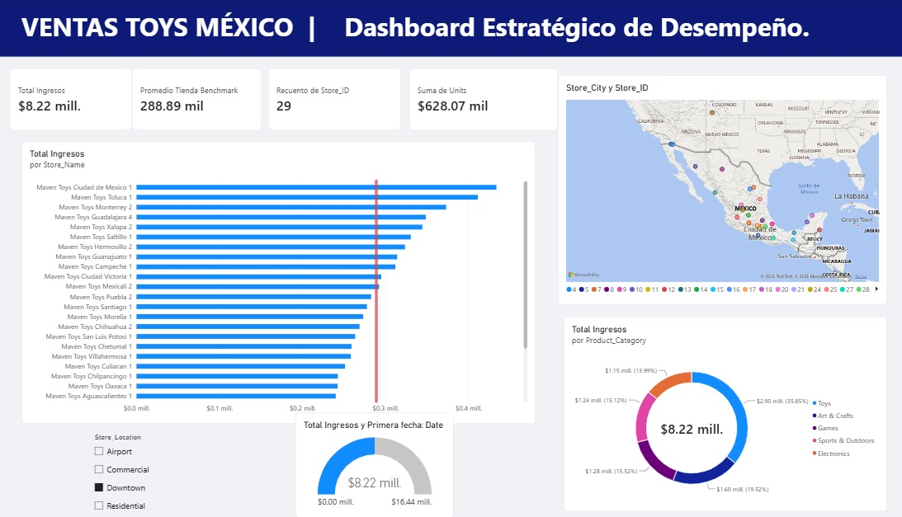
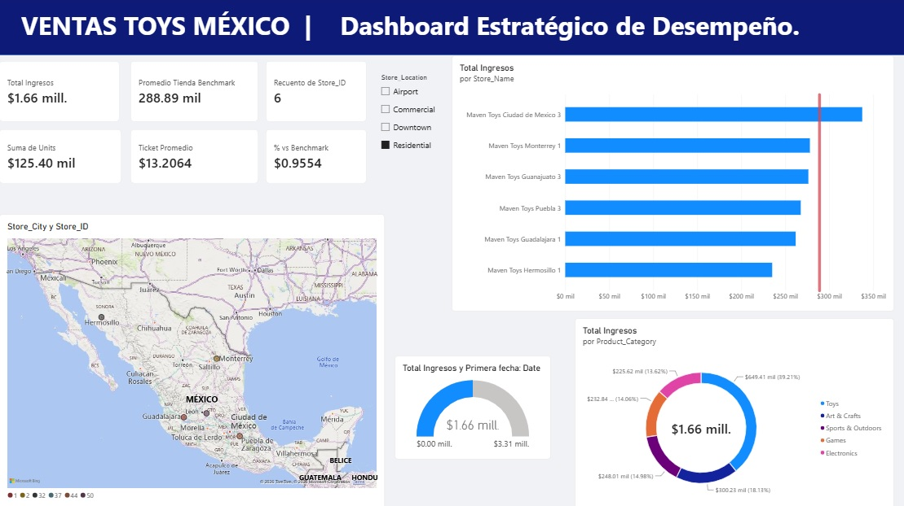

# 🧸 Mexico Toys Sales Analytics | Dashboard Ejecutivo en Power BI


# 🇲🇽 Mexico Toy Sales: Análisis de Negocio y Segmentación

Proyecto integral de análisis de datos, ingeniería y business intelligence enfocado en el rendimiento comercial de la cadena **Maven Toys** en México. Este repositorio documenta el flujo de trabajo completo, desde la gestión de bases de datos relacionales y scripts en Python hasta la segmentación de tiendas y la visualización ejecutiva en Power BI.

---

## 🛠️ Estructura del Repositorio

```text
mexico_toy_sales/
│
├── data/                    # Archivos de datos originales (CSV) y base de datos SQLite
│   ├── raw/                 # Datos fuente (sales, products, stores, inventory, calendar)
│   └── mexico_toy_sales.db  # Base de datos SQLite principal
│
├── src/                     # Scripts de Python para procesamiento y análisis
│   ├── carga.py             # Automatización de carga de datos a SQLite
│   └── segmentacion_tiendas.py # Análisis avanzado de tiendas y productos críticos
│
├── sql/                     # Consultas SQL estructuradas para el negocio
│   └── consultas_negocio.sql # CTEs para segmentación y métricas clave
│
├── dashboard/               # Recursos y archivos del reporte interactivo (Power BI)
├── notebooks/               # Cuadernos Jupyter para EDA (Exploratory Data Analysis)
└── README.md                # Documentación oficial del proyecto

---

## 📊 Hallazgos y Objetivos Clave

Segmentación de Tiendas:

Se estableció un promedio general de ingresos por tienda de $288,891.45.

Se identificaron sucursales con rendimiento crítico por debajo del umbral (destacando casos como Campeche 2, La Paz 1 y Cuernavaca 1) para enfocar estrategias comerciales y operativas específicas.

Análisis de Productos Críticos (Bottom 10):

Evaluación de artículos con menor rotación e ingresos (ej. Uno Card Game, Classic Dominoes, Playfoam) para optimizar la gestión de inventarios y campañas de marketing.

Modelo de Datos (Star Schema):

Relaciones estructuradas entre la tabla de hechos de ventas (sales) y las dimensiones de productos, tiendas y calendario para garantizar cálculos precisos.

---

## ⚙️ Requisitos Técnicos y Entorno
El proyecto utiliza Python y bibliotecas especializadas para análisis de datos y conectividad con bases de datos relacionales.

Python 3.x

Pandas (Manipulación y análisis de estructuras de datos)

SQLite3 (Gestión de base de datos embebida)

Instalación del Entorno Virtual
1. Clona el repositorio y activa tu entorno virtual:

Bash
python -m venv .venv
source .venv/Scripts/activate  # En Windows (Git Bash / PowerShell)

2.Ejecuta el script de segmentación y análisis directamente:

Bash
python src/segmentacion_tiendas.py

---

## 📈 Dashboard Interactivo (Power BI)
El modelo de datos y las métricas calculadas se integran en un reporte interactivo estructurado en tres niveles:

Resumen Ejecutivo: KPIs globales de ingresos, unidades y evolución temporal.

Segmentación de Tiendas: Vista comparativa frente a la línea base de rendimiento y filtros por tipo de ubicación (Downtown, Commercial, Residential).


## 📌 Descripción del Proyecto
Este proyecto desarrolla un **Tablero de Control Ejecutivo e Interactivo en Power BI** para analizar el rendimiento comercial y la distribución geográfica de una cadena nacional de tiendas de juguetes en México.

El objetivo principal es brindar visibilidad a la alta dirección sobre el volumen de ventas, el cumplimiento del rendimiento esperado por sucursal (*Benchmark*) y el comportamiento del inventario según la categoría de producto y la ubicación geográfica de las tiendas.

---

## 🛠️ Arquitectura del Modelo de Datos (Esquema en Estrella)

El modelo relacional fue estructurado siguiendo las mejores prácticas de Inteligencia de Negocios en un **Esquema en Estrella** (*Star Schema*):

* **`sales` (Tabla de Hechos):** Transacciones individuales conteniendo `Sale_ID`, `Date`, `Store_ID`, `Product_ID` y `Units`.
* **`stores` (Dimensión):** Información de las 29 sucursales únicas, incluyendo `Store_Name`, `Store_City`, `Store_Location` (Airport, Commercial, Downtown, Residential) y fecha de apertura.
* **`products` (Dimensión):** Catálogo de productos detallado por `Product_Name`, `Product_Category`, costo y precio de venta.
* **`calendar` (Dimensión):** Tabla de tiempo jerárquica para análisis temporal.
* **`inventory` (Dimensión):** Niveles de existencias por producto y sucursal.

---

## 🧮 Medidas DAX Implementadas

Se crearon métricas avanzadas en DAX para el análisis del negocio:

* **Total Ingresos:**
  ```dax
  Total Ingresos = SUMX(sales, sales[Units] * RELATED(products[Product_Price]))

Promedio Tienda Benchmark:
Promedio Tienda Benchmark = 288891.45

Ticket Promedio:
Ticket Promedio = DIVIDE([Total Ingresos], SUM(sales[Units]), 0)

% vs Benchmark:
% vs Benchmark = DIVIDE([Total Ingresos], [Promedio Tienda Benchmark] * DISTINCTCOUNT(stores[Store_ID]), 0)

---

## 🚀 Key Business Insights (Principales Hallazgos)

1. Desempeño por Sucursales: La sucursal Maven Toys Ciudad de México 1 lidera las ventas a nivel nacional superando significativamente la línea de Benchmark ($288.89K).

2. Distribución por Categoría: La categoría Toys concentra la mayor participación de mercado (~35.85%), seguida de Art & Crafts (~19.52%) y Electronics (~15.52%).

3. Ubicación Estratégica: Las tiendas en zonas Downtown aportan la mayor proporción de facturación al grupo comercial, mientras que las ubicaciones Residential mantienen un ticket promedio consistente de $13.20.

---

## 📊 Vista General del Dashboard

### 1. Vista General de Rendimiento Comercial (Downtown)



### 2. Análisis Segmentado por Ubicación (Residential)



---

## 🧰 Tecnologías Utilizadas

Power BI Desktop: Modelado de datos, creación de medidas DAX, maquetación UI/UX y maquetación de gráficos dinámicos.

SQLite / CSV: Fuente de origen y procesamiento de datos tabulares.

Git & GitHub: Control de versiones y documentación del proyecto.

---

## 🚀 Control de Versiones
El desarrollo del proyecto se administra mediante flujos de ramas en Git:

main: Rama de producción y entregas estables.

developer: Rama activa para integración de scripts de Python, consultas SQL y validaciones de datos.

